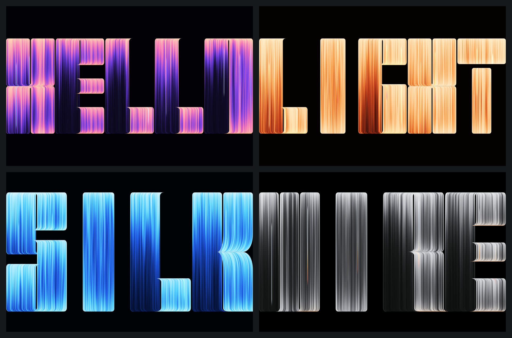
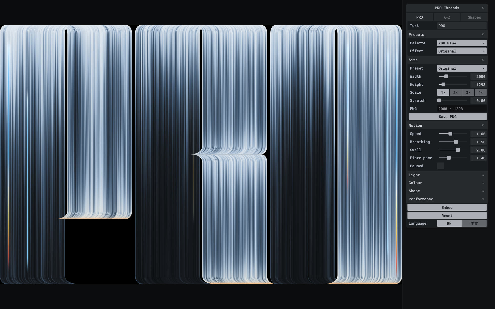
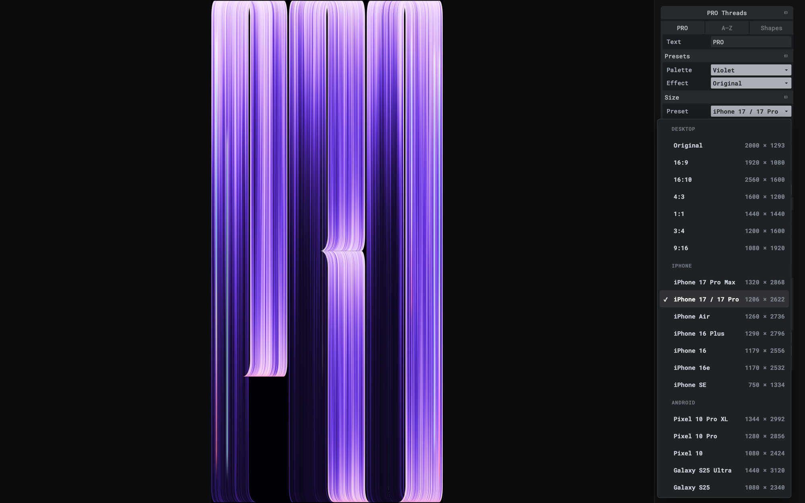
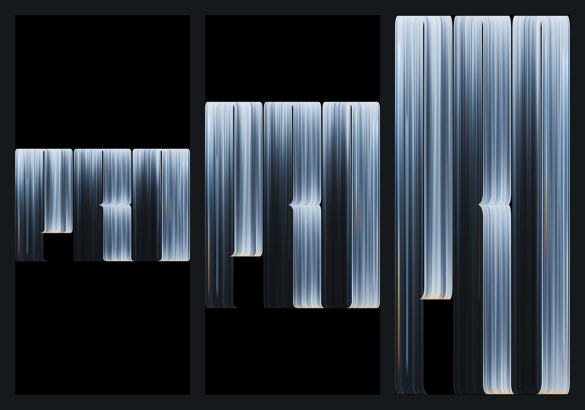
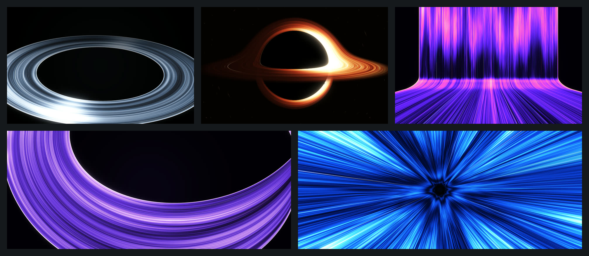
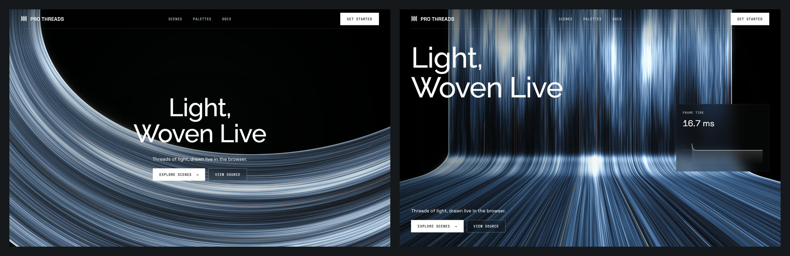
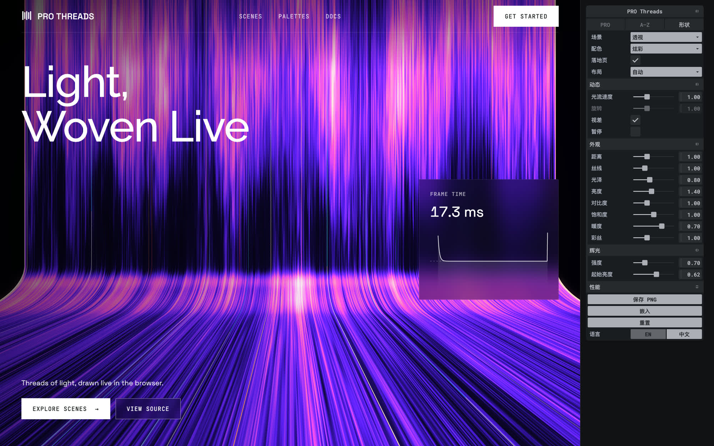
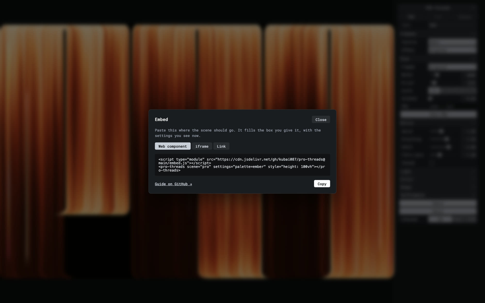

# PRO Threads

**Letters woven from thousands of threads of light, drawn live in WebGL.** An animated wallpaper inspired by the MacBook Pro PROLED XDR wallpaper, rebuilt from scratch as a real-time shader, with a full A–Z thread typeface, palettes, a settings panel, hero scenes for landing pages and a drop-in `<pro-threads>` web component.

[](LICENSE)
[](#run-locally)
[](#browser-support)
[](https://www.kubai.design/pro-threads/)


**[Live demo](https://www.kubai.design/pro-threads/)** · [A–Z](https://www.kubai.design/pro-threads/?view=az) · [Hero scenes](https://www.kubai.design/pro-threads/hero/) · [Embed it](#embed) · [URL parameters](#settings-and-url-parameters)

## Contents

- [Features](#features)
- [Gallery](#gallery)
- [Embed](#embed)
- [Settings and URL parameters](#settings-and-url-parameters)
- [Keyboard shortcuts](#keyboard-shortcuts)
- [Run locally](#run-locally)
- [How it works](#how-it-works)
- [Project structure](#project-structure)
- [Browser support](#browser-support)
- [Performance](#performance)
- [Contributing](#contributing)
- [Credits and trademarks](#credits-and-trademarks)
- [License](#license)

## Features

- **Live, not a video.** One full-screen fragment shader. The light breathes, sweeps and drifts along every thread, and coloured fibres warm up as they pass.
- **A whole typeface.** All 26 letters are built from the same parts: two halves split by a slit, cut into bands, each end bending as an arch, dome, sweep, wedge or foot. Type any word of up to 10 letters, or show the whole alphabet.
- **Palettes and effects.** 9 palettes (XDR Blue, Graphite, Ember, Chroma, Violet, Ocean, Aurora, Rose Gold, Paper) with hue-shifting ramps and matching fibres, and 7 effect presets (Original, Calm, Lively, Silk, Fine Wire, Glow, Low Light). Every colour, light and shape value can be tuned by hand.
- **Any size.** Desktop presets from 16:9 to 9:16, current iPhone and Android phones, or a custom size. **Stretch** eases the letters from keeping their proportions to filling the frame.
- **PNG export.** Save at 1×–4× (phone presets default to the phone's own scale, so iPhone 17 Pro gives 1206 × 2622). Large images are drawn in tiles, up to 16384 px a side.
- **Hero scenes.** Five 3D scenes made of the same threads, for the first screen of a landing page: a ring, a ray-traced black hole, a wide-angle perspective, a Möbius strip and a tunnel, each with a glow pass, a colour grade and pointer parallax. A demo landing page shows how a scene sits behind real content.
- **Settings in the URL.** Whatever you change is written into the address, so a reload, a bookmark or a shared link opens the same look.
- **English and Chinese.** The panel switches to Simplified Chinese at its foot or with `?lang=zh`.
- **Easy to embed.** The panel's **Embed** button gives ready-to-paste code with your current settings; one script tag puts a live scene on any site.
- **Light on the machine.** At most 60 frames a second by default, no drawing while hidden, paused or scrolled out of view, and resolution that adapts when frames run slow.
- **No build step.** Plain ES modules and a static folder. Serve it and open it.

## Gallery

**Palettes.** Nine palettes, each a ramp that shifts hue as it brightens, with fibres from the same family.


**The A–Z typeface.** Every letter keeps the original's proportions and is built from the same few parts (`?view=az`).


**Your own words**, with palettes and effects: `HELLO` in Chroma, `LIGHT` in Ember with Glow, `SILK` in Ocean with Silk, `WIRE` in Graphite with Fine Wire.



**The settings panel.** Presets, size, motion, light, colour, shape and performance, all live.



**Sizes.** Desktop, iPhone and Android presets, each listed with the PNG it saves.



**Stretch** on an iPhone 17 Pro screen: `0` keeps the letters' proportions, `1` fills the frame across and down.



**Hero scenes**: ring, black hole, perspective, Möbius strip and tunnel.



**The demo landing page** laid over the Möbius strip (centred) and the perspective (on the left, with a live frame-time chart).



**The hero panel**, here in Chinese (`?lang=zh`).



**The Embed dialog** gives the web component, an iframe or a link, with your settings already in it.



## Embed

Put a live scene on your own site, landing page or product.

**The quickest way:** open the [wallpaper](https://www.kubai.design/pro-threads/) or the [hero scenes](https://www.kubai.design/pro-threads/hero/), set it up in the panel, press **Embed** at the foot of the panel, then **Copy**. You get one of the snippets below with your settings already filled in.

### Web component

Works in plain HTML and in any framework:

```html
<script type="module" src="https://cdn.jsdelivr.net/gh/kubai087/pro-threads@main/embed.js"></script>

<pro-threads scene="mobius" palette="ember" style="height: 100vh"></pro-threads>
```

The scene fills the element's box (at least 200 px tall). It runs in an iframe, so it cannot clash with your page's styles or scripts; it loads lazily, is hidden from screen readers and the tab order as decoration, and stops drawing while scrolled out of view.

| Attribute | Values |
| --- | --- |
| `scene` | `pro` (the wallpaper, default), `az` (the alphabet), `ring`, `blackhole`, `perspective`, `mobius`, `tunnel` |
| `text` | the word on the wallpaper, up to 10 letters, e.g. `text="HELLO"` |
| `palette` | `xdr-blue`, `graphite`, `ember`, `chroma`, `violet`, `ocean`, `aurora`, `rose-gold`, `paper` |
| `fps` | the most frames a second: `30`, `60` (default) or `120` |
| `settings` | any other setting, as a query string, e.g. `settings="speed=0.6&glow=1.2"` (see [URL parameters](#settings-and-url-parameters); the Embed button writes it for you) |
| `src` | the address of your own copy of this site, if you host one (see [Self-hosting](#self-hosting)) |

All attributes are optional. Changing one from script updates the scene in place. Hero scenes are embedded without the demo landing page unless `settings` says `landing=1`.

### As a background

```html
<section style="position: relative; min-height: 100vh">
  <pro-threads scene="tunnel" style="position: absolute; inset: 0; z-index: -1"></pro-threads>
  <h1>Your headline</h1>
</section>
```

### From npm

The package installs straight from this repository:

```bash
npm install github:kubai087/pro-threads
```

```js
import 'pro-threads'; // defines <pro-threads>
```

The package's code is just `embed.js`; the scene itself is still loaded from the hosted site, or from your own copy via `src`.

- **React 19 / Next.js:** use `<pro-threads scene="ring" />` like any element. In Next.js, import the package in a client component (`'use client'`). With TypeScript, declare the element once:

  ```ts
  declare module 'react' {
    namespace JSX {
      interface IntrinsicElements { 'pro-threads': any }
    }
  }
  ```

- **Vue:** tell the compiler it is a custom element: `compilerOptions.isCustomElement = (tag) => tag === 'pro-threads'`.

### iframe

If you would rather not load a script, add `embed=1` to a page's address. It hides the panel, turns off the keys, leaves the URL alone and fits the scene to the frame.

```html
<iframe src="https://www.kubai.design/pro-threads/hero/?scene=ring&landing=0&embed=1"
  title="PRO Threads" loading="lazy" style="display: block; width: 100%; height: 100vh; border: 0"></iframe>
```

### Self-hosting

It is a static folder with no build step. Fork this repository and turn on GitHub Pages (*Settings → Pages → Deploy from a branch → `main`, `/ (root)`*), or copy the folder onto any web server. Then point the element at your copy with `src`:

```html
<pro-threads src="https://you.github.io/pro-threads/" scene="ring"></pro-threads>
```

The Embed button on your copy adds `src` for you.

### Pinning a version

`@main` always loads the latest `embed.js` from this repository (jsDelivr caches it for a while). To keep one fixed, use a commit instead:

```html
<script type="module" src="https://cdn.jsdelivr.net/gh/kubai087/pro-threads@<commit>/embed.js"></script>
```

The element only builds the iframe's address; what the scene looks like comes from the site it points at (the hosted demo by default, or your own copy via `src`). Self-host if you need the scene itself to stay fixed.

## Settings and URL parameters

What you change in the panel is written into the URL (only what differs from the defaults), so a reload, a bookmark or a shared link opens the same look. Going between the wallpaper and the hero scenes (the panel's **PRO / A–Z / Shapes** tabs) comes back to where you left each, and carries the palette across. A **hard reload** (bypassing the cache) starts from the defaults again. The panel's **Reset** button returns its values to the defaults, keeping the current view or scene.

Every setting can also be given directly in the URL. Colours are hex without the `#`, switches are `1` or `0`.

### Both pages

| Parameter | Effect |
| --- | --- |
| `t=7` | Hold one moment, in seconds of the light's clock, and stop animating (for stills and screenshots) |
| `ui=0` | Start with the panel hidden (`H` shows it) |
| `embed=1` | Embedded mode: no panel, no keys, the URL is left alone, and the scene fits its frame |
| `lang=zh` | The panel in Simplified Chinese |
| `palette=` | `xdr-blue` (default), `graphite`, `ember`, `chroma`, `violet`, `ocean`, `aurora`, `rose-gold`, `paper` |
| `fps=` | The most frames a second: `30`, `60` (default) or `120` |
| `quality=` | Share of the screen's pixels drawn, `0.4`–`1` (default `0.75` on high-density screens, else `1`) |
| `autoQuality=0` | Keep the resolution fixed instead of lowering it when frames run slow |
| `paused=1` | Start paused |

### Wallpaper (`/`)

| Group | Parameters (default) |
| --- | --- |
| View | `view=az` (the alphabet; omit for the word), `text` (`PRO`, up to 10 letters A–Z and spaces) |
| Presets | `effect`: `original` (default), `calm`, `lively`, `silk`, `fine-wire`, `glow`, `low-light`. A palette or effect sets a group of values; any value given alongside overrides it |
| Size | `width` (`2000`), `height` (`1293`), `scale` (`1`–`4`, the PNG's multiplier), `stretch` (`0`–`1`) |
| Motion | `speed` (`1.6`), `breathe` (`1.5`), `swell` (`2`), `fibrePace` (`1.4`) |
| Light | `gain` (brightness, `1.5`), `reach` (`1`), `floorDim` (`0.2`), `floorLit` (`0.52`), `density` (threads, `1`), `texture` (`1`), `rim` (edge rim, `1`) |
| Colour | `shadow`, `steel`, `silver`, `highlight` (the ramp), `glow` (edge glow), `background`, `fibreCool`, `warmLight`, `warmMid`, `warmDeep` (the fibres), `warm` (`0.6`), `sparkle` (fibres, `1`) |
| Shape | `corner` (`28`), `arch` (`40`), `tip` (`66`), in the original's pixels |
| Alphabet | `spacing` (`90`, between letters in pixels), `rowGap` (`0.22`, in letter heights) |
| Reference | `ref=0.5` overlays your own `reference.webp` at that opacity (see [Reference image](#reference-image)) |

Examples:

- `?text=HELLO&palette=chroma&effect=calm&speed=1.2`
- `?width=402&height=874&scale=3&stretch=1` (iPhone 17 Pro, saves a 1206 × 2622 PNG, letters fill the screen)
- `?palette=ember&background=1a0500&rim=1.6`

### Hero scenes (`/hero/`)

| Group | Parameters (default) |
| --- | --- |
| Scene | `scene`: `ring` (default), `blackhole`, `perspective`, `mobius`, `tunnel` |
| Landing page | `landing=0` hides the demo landing page; `layout`: `auto` (default, each scene's own), `left`, `center` |
| Motion | `speed` (light speed, `1`), `spin` (turn, `1`), `parallax` (`1`) |
| Look | `zoom` (distance, `1`), `threads` (`1`), `sheen` (`0.8`), `gain` (brightness, `1.4`), `contrast` (`1`), `saturation` (`1`), `warm` (`0.7`), `sparkle` (fibres, `1`) |
| Glow | `glow` (strength, `0.7`), `threshold` (where the glow starts, `0.62`) |

Examples:

- `?scene=blackhole&palette=ember`
- `?scene=perspective&palette=chroma&layout=center`
- `?scene=tunnel&palette=ocean&landing=0&ui=0`

The hero panel's **Save PNG** saves the scene at twice the canvas's size.

## Keyboard shortcuts

| Key | Action |
| --- | --- |
| `H` | Show or hide the panel |
| `Space` | Pause or resume |
| `R` | Overlay the reference image (wallpaper only, if you provide one) |
| `Esc` | Close the Embed dialog or a dropdown |

Keys are ignored while typing in a field, with a modifier held (so browser shortcuts keep working) and in embedded mode. Dropdowns also work with the arrow keys, `Enter` and `Space`.

## Run locally

There is nothing to install or build. Serve the folder over HTTP (ES modules do not load from `file://`):

```bash
git clone https://github.com/kubai087/pro-threads.git
cd pro-threads
python3 -m http.server 8765
```

Then open <http://localhost:8765> for the wallpaper and <http://localhost:8765/hero/> for the hero scenes. Any static server works (`npx serve`, `php -S`, and so on).

Tweakpane and its Essentials plugin are loaded from jsDelivr, and the hero page's fonts from Google Fonts, so the first load needs a network connection.

### Reference image

To compare against the original wallpaper, put your own copy next to `index.html` as `reference.webp` and press `R` (or open with `?ref=0.5`). It is not included in this repository and is ignored by git.

## How it works

### The wallpaper

Not noise, mostly geometry. Each letter is a few **sheets** of parallel vertical threads. At each end of a sheet every thread runs straight, then eases into a turn until it lies flat along the end, and how far a thread travels sideways is linear across the sheet. So the sheet's own outer threads draw the outline: rounded corners, pointed arches over the slit, long flared tips.

Because the offset is linear in a thread's own coordinate **ψ**, each pixel can solve exactly which thread it lies on. One full-screen pass then, for every pixel:

1. **Finds** the row, letter and sheets under the pixel.
2. **Solves ψ**, the distance to the sheet's edge and how steeply the thread lies there; edges are anti-aliased by distance over gradient.
3. **Averages the threads** under the pixel. Where threads lie flat they overlap, so their stripes melt into a smooth sheen.
4. **Lights** each thread: a fall-off fitted to the original's brightness, plus slow breathing, a sweeping swell and bands drifting along the threads.
5. **Colours** it through the palette's ramp with a soft highlight roll-off, then adds the edge rim, the coloured fibres and the warm glow where the light ends.
6. **Composites** overlapping sheets as translucent strands, so both show where they cross over a slit.

Per-thread variation comes from hashes of ψ and three layers of value noise. The letters' sheets and fibres are packed into a small float texture (`letters.js`) that the shader reads texel by texel. Saved PNGs are drawn in tiles and copied into one 2D canvas, so they can be larger than WebGL draws at once.

### The hero scenes

The ring, perspective, Möbius strip and tunnel are **ribbon meshes**: bands of threads laid along a curve, with `u` running along the threads and `v` across them (`hero/shapes.js`). They are drawn multisampled with depth and shaded the way the wallpaper is: each thread its own level, broader bands over that, light drifting along the threads, and the palette's ramp, rim and fibres. The Möbius strip's threads meet themselves in the opposite order after a half twist, and the shader blends across the join.

The **black hole** is a single ray-traced pass: rays bend round the hole, so its accretion disk is seen over and under it, with a photon ring.

Every scene then gets a **glow**: what is bright is blurred at a quarter and an eighth of the size and laid back over the picture, followed by a contrast and saturation grade.

## Project structure

| Path | What it is |
| --- | --- |
| `index.html`, `style.css` | The wallpaper page and its layout |
| `wallpaper.js` | The wallpaper: settings, WebGL setup, drawing, PNG export and the panel |
| `letters.js` | The A–Z typeface as sheets of threads, and `pack()`, which lays out rows of letters for the shader |
| `shader.js` | The wallpaper's vertex and fragment shaders |
| `palettes.js` | The nine palettes, shared by both pages |
| `pace.js` | When to draw: the frame-rate cap, pausing offscreen or hidden, and noticing slow frames |
| `persist.js` | Settings in the URL, per-tab memory of each page's settings, hard-reload detection, embedded mode |
| `menu.js` | The panel's custom dropdowns, with grouped options and details |
| `i18n.js` | English and Simplified Chinese for the panel |
| `share.js` | The Embed dialog and its snippets |
| `embed.js` | The `<pro-threads>` web component (the npm package's entry point) |
| `hero/index.html`, `hero/style.css` | The hero scenes page, its layout and the demo landing page's styles |
| `hero/hero.js` | The hero scenes: cameras, render targets, the glow pass and the panel |
| `hero/shaders.js` | The ribbon, black hole, backdrop, glow and composite shaders |
| `hero/shapes.js` | The ribbon meshes: ring, perspective wall, Möbius strip and tunnel |
| `hero/landing.js` | The demo landing page laid over a scene, with a live frame-time chart |
| `media/` | Screenshots for this README, rendered from this project |
| `favicon.svg`, `favicon-32.png`, `apple-touch-icon.png` | Icons |

## Browser support

PRO Threads needs **WebGL 2**. It is written for current versions of Chrome, Edge, Safari and Firefox, and also relies on ES modules, CSS container queries, `ResizeObserver` and `IntersectionObserver`, all available in those browsers. Without WebGL 2 the canvas stays blank.

## Performance

- **60 fps cap** by default. A 120 Hz screen does not need to draw the light twice as often; choose 30, 60 or 120 in the panel or with `fps=`.
- **Pauses when not seen.** Nothing is drawn while the canvas is scrolled out of view, the tab is hidden or the scene is paused.
- **Automatic resolution.** On high-density screens 75% of the screen's pixels are drawn. If frames keep running well over budget, the resolution steps down on its own (to no less than half); turn this off with **Auto** in the Performance folder or `autoQuality=0`.
- **Stills are free.** With `t=` the page draws once and stops.

## Contributing

Issues and pull requests are welcome. See [CONTRIBUTING.md](CONTRIBUTING.md) for how to run the project, the code style and the commit message format. Please report security issues privately as described in [SECURITY.md](SECURITY.md). Changes are recorded in [CHANGELOG.md](CHANGELOG.md).

## Credits and trademarks

- Inspired by the MacBook Pro PROLED XDR wallpaper by Apple. This project is an independent re-creation written from scratch; it is **not affiliated with, endorsed by or sponsored by Apple Inc.** Apple, MacBook Pro and PROLED XDR are trademarks of Apple Inc.
- No Apple artwork is included. The original wallpaper image is not part of this repository; `reference.webp` is git-ignored and only used locally if you supply your own copy.
- [Tweakpane](https://tweakpane.github.io/docs/) and [@tweakpane/plugin-essentials](https://github.com/tweakpane/plugin-essentials) are MIT licensed and loaded from jsDelivr.
- The demo landing page uses [Space Grotesk](https://fonts.google.com/specimen/Space+Grotesk), [Raleway](https://fonts.google.com/specimen/Raleway) and [JetBrains Mono](https://fonts.google.com/specimen/JetBrains+Mono) from Google Fonts, under the SIL Open Font License.

## License

[MIT](LICENSE) © Kubai087. The license covers the code and the images in `media/`, which are renders of this project.
