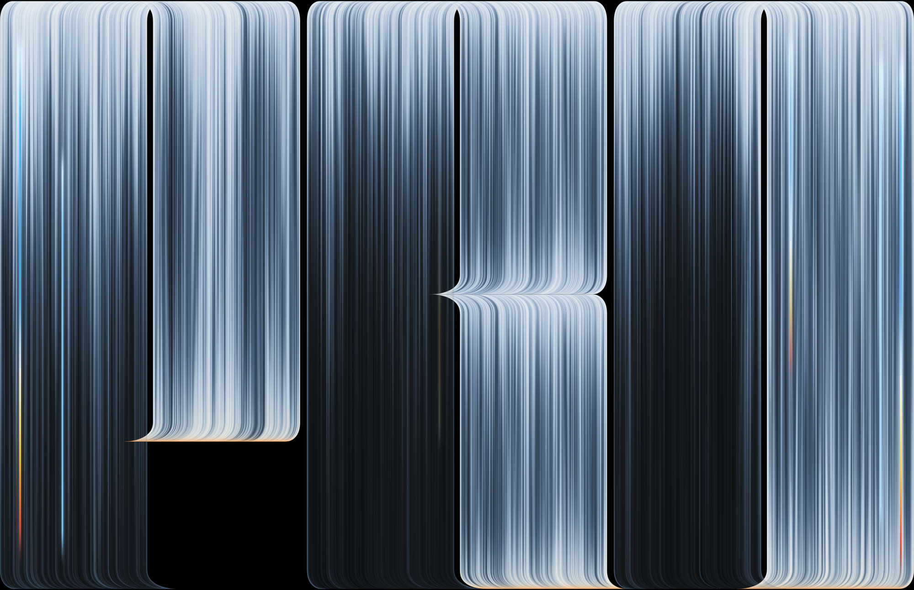
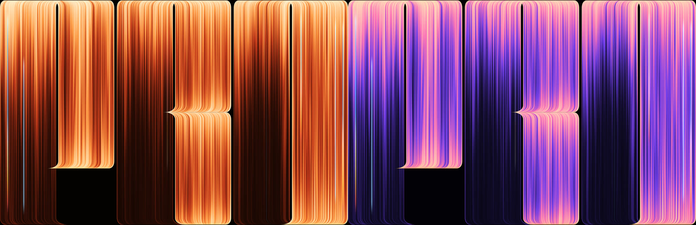
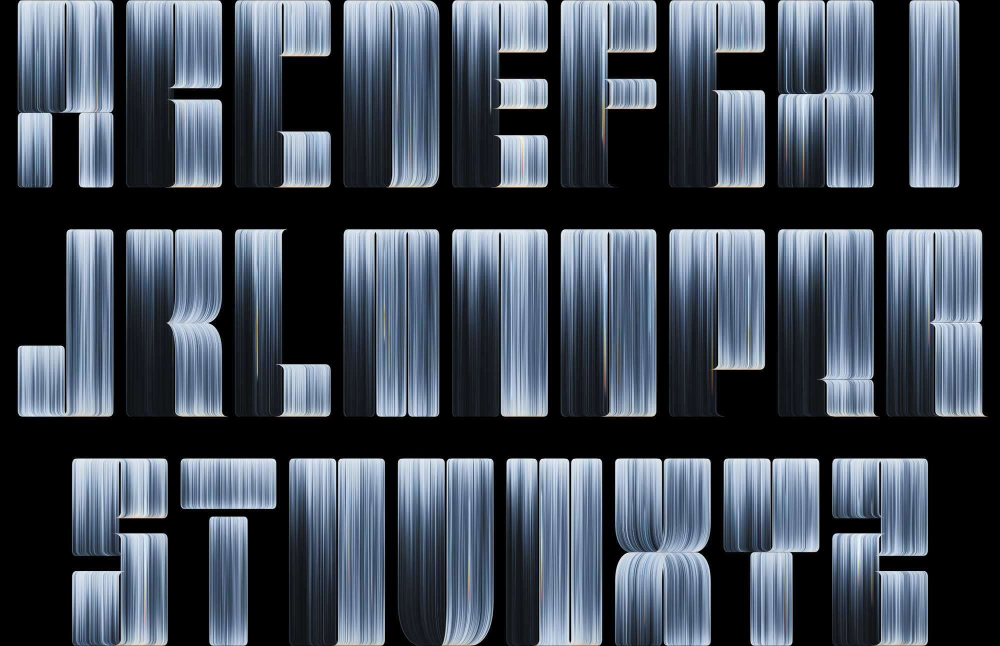
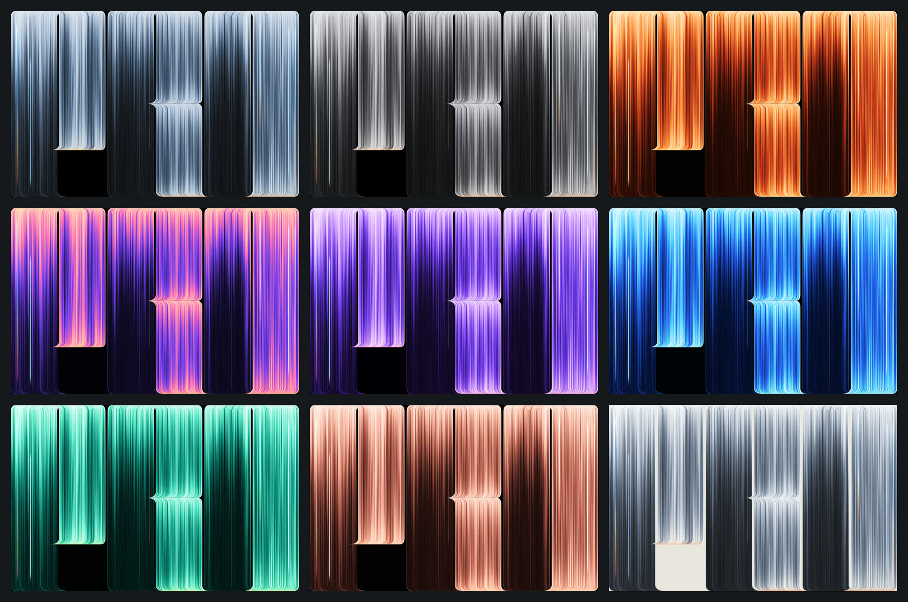
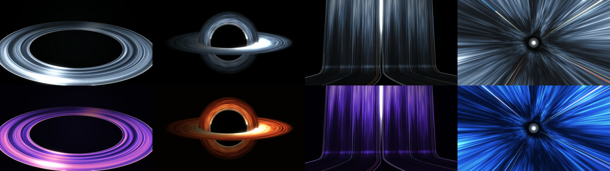

# PRO Threads

An animated, real-time WebGL wallpaper: letters made of thousands of fine threads of light that bend, flare and glow — inspired by the MacBook Pro PROLED XDR wallpaper, rebuilt from scratch as a live shader, with a full A–Z thread typeface, palettes and a settings panel.

一个实时渲染的 WebGL 动态壁纸：字母由成千上万根细光线组成，线条整体弯折、甩尖、发光。灵感来自 MacBook Pro PROLED XDR 壁纸的视觉风格，用着色器从零重写，并扩展成完整的 A–Z 字体，带配色预设和参数面板。

**Live demo / 在线体验：** <https://www.kubai.design/pro-threads/> · [A–Z](https://www.kubai.design/pro-threads/?view=az) · [Chroma](https://www.kubai.design/pro-threads/?palette=chroma) · [Ember](https://www.kubai.design/pro-threads/?palette=ember&effect=glow) · **[Hero scenes](https://www.kubai.design/pro-threads/hero/)**





## Features

- **Live, not a video** — one full-screen fragment shader, 60 fps on a laptop GPU; the light breathes, sweeps and drifts along every thread.
- **A whole typeface** — all 26 letters built from the same parts: two halves split by a slit, cut into bands, each end bending as an arch, sweep, foot, wedge or dome. Type any word up to 10 letters.
- **Palettes and effects** — 9 palettes (XDR Blue, Graphite, Ember, Chroma, Violet, Ocean, Aurora, Rose Gold, Paper) with hue-shifting ramps and matched glowing fibres; 7 effect presets (Calm, Lively, Silk, Fine Wire, Glow, Low Light…).
- **Any size** — desktop presets from 16:9 to 9:16, current iPhone and Android phones, or a custom size. Save a PNG at 1×–4× (phones default to their own scale, so an iPhone 17 Pro gives 1206 × 2622); large images are drawn in tiles, up to 16384 px a side. **Stretch** eases the letters from keeping their proportions to filling the frame across and down.
- **Fast** — renders at 75% of screen pixels on dense displays, lowers resolution by itself if frames run slow, draws at most 60 frames a second (30 or 120 if you like), and stops drawing while paused, hidden or scrolled out of view.
- **Easy to embed** — the panel's **Embed** button copies ready-made code with your settings; one script tag puts a live scene on any site (see [Embed](#embed)).





## Hero scenes

The same threads of light, as first screens for a landing page: a **ring**; a **black hole**, ray traced so its accretion disk is seen bent over and under the hole, with a photon ring; a wide-angle **perspective** of a wall of fine threads rolling onto the floor; a **Möbius strip** larger than the screen, one band with a half twist whose threads run on into themselves, its centre wandering round off screen so only a sweep of it crosses the frame; and a **tunnel** of fine threads running away into the dark. Each is drawn with a glow pass and a contrast and saturation grade, takes 1–4 ms a frame, and follows the pointer with a little parallax. The panel's **PRO / A–Z / Shapes** tabs switch between the wallpaper and the scenes, keeping the palette.

同样的光线丝线，做成落地页首屏：**圆环**；光线追踪的**黑洞**（吸积盘被引力弯折到黑洞上下，带光子环）；广角**透视**（一面丝线墙翻落到地面、向镜头散开）；以及冲向发光消失点的**隧道**。全部带辉光和对比度、饱和度调色，面板上的 PRO / A–Z / Shapes 标签可以在壁纸和场景之间切换。

[Open the hero scenes →](https://www.kubai.design/pro-threads/hero/) · [Black hole](https://www.kubai.design/pro-threads/hero/?scene=blackhole) · [Perspective](https://www.kubai.design/pro-threads/hero/?scene=perspective&palette=chroma) · [Tunnel](https://www.kubai.design/pro-threads/hero/?scene=tunnel&palette=ocean)



A demo landing page is laid over the scene to show how it sits behind real content: centred over the ring, black hole, Möbius strip and tunnel, and on the left with a live frame-time chart over the perspective. Pick the layout in the panel (`?layout=left|center`), or turn it off (`?landing=0`).

URL options: `?scene=ring|blackhole|perspective|mobius|tunnel`, `?palette=chroma`, `?landing=0`, `?layout=left|center`, `?ui=0`. Keys: `H` hides the panel, `Space` pauses.

## Embed

Put a live scene on your own site, landing page or product.

**The quickest way:** open the [wallpaper](https://www.kubai.design/pro-threads/) or the [hero scenes](https://www.kubai.design/pro-threads/hero/), set it up in the panel, then press **Embed** at the foot of the panel and **Copy**. You get one of these, with your settings already in it.

**Web component** (works in plain HTML and in any framework):

```html
<script type="module" src="https://cdn.jsdelivr.net/gh/kubai087/pro-threads@main/embed.js"></script>

<pro-threads scene="mobius" palette="ember" style="height: 100vh"></pro-threads>
```

The scene fills the element's box. It runs in an iframe, so it can't clash with your page's styles or scripts, and it pauses while scrolled out of view.

| Attribute | Values |
| --- | --- |
| `scene` | `pro` (the wallpaper, default), `az` (the alphabet), `ring`, `blackhole`, `perspective`, `mobius`, `tunnel` |
| `text` | the word on the wallpaper, up to 10 letters, e.g. `text="HELLO"` |
| `palette` | `xdr-blue`, `graphite`, `ember`, `chroma`, `violet`, `ocean`, `aurora`, `rose-gold`, `paper` |
| `fps` | the most frames a second: `30`, `60` (default) or `120` |
| `settings` | any other panel setting, as a query string, e.g. `settings="speed=0.6&glow=1.2"` (the Embed button writes it for you) |
| `src` | the address of your own copy of this site, if you host one (see below) |

Changing an attribute from script updates the scene in place.

**As a background behind your own content:**

```html
<section style="position: relative; min-height: 100vh">
  <pro-threads scene="tunnel" style="position: absolute; inset: 0; z-index: -1"></pro-threads>
  <h1>Your headline</h1>
</section>
```

**From npm** (installs straight from this repository):

```bash
npm install github:kubai087/pro-threads
```

```js
import 'pro-threads'; // defines <pro-threads>
```

- **React 19 / Next.js:** use `<pro-threads scene="ring" />` like any element; in Next.js, import the package in a client component (`'use client'`). With TypeScript, declare it once: `declare module 'react' { namespace JSX { interface IntrinsicElements { 'pro-threads': any } } }`.
- **Vue:** tell the compiler it is a custom element: `compilerOptions.isCustomElement = (tag) => tag === 'pro-threads'`.

**iframe**, if you'd rather not load a script: add `embed=1` to a page's address, which hides the panel and fits the scene to the frame.

```html
<iframe src="https://www.kubai.design/pro-threads/hero/?scene=ring&landing=0&embed=1"
  title="PRO Threads" loading="lazy" style="width: 100%; height: 100vh; border: 0"></iframe>
```

**Hosting your own copy:** it is a static folder with no build step. Fork this repository and turn on GitHub Pages (*Settings → Pages → Deploy from a branch → main, / (root)*), or copy the folder onto any web server. Then point the element at it with `src`, e.g. `<pro-threads src="https://you.github.io/pro-threads/" scene="ring">`; the Embed button on your copy adds this for you.

`@main` always loads the latest version. To keep one fixed, use a commit instead, e.g. `…/gh/kubai087/pro-threads@<commit>/embed.js`.

## Run it

It is a static page with no build step. Serve the folder over HTTP (ES modules don't load from `file://`):

```bash
python3 -m http.server 8765
```

Then open <http://localhost:8765>.

**Language:** the panel is in English; switch it to Simplified Chinese at its foot, or open with `?lang=zh`.

**Keys:** `H` hides the panel · `Space` pauses · `R` overlays a reference image (see below).

**Settings and the URL:** what you change in the panel is written into the URL (only what differs from the defaults), so a reload, a bookmark or a shared link opens the same look, and going between PRO, A–Z and Shapes comes back to where you left each. A hard reload starts from the defaults again.

**URL options:** every panel value can be set in the URL, for example
`?text=HELLO&palette=chroma&effect=calm&speed=1.5` or `?width=402&height=874&scale=3&stretch=1`, plus `?view=az` (the alphabet), `?ui=0` (no panel) and `?t=7` (freeze one moment, for stills).

## How it works

Not noise, mostly geometry. Each letter is a few **sheets** of parallel threads. At each end of a sheet every thread runs straight, then eases into a turn until it lies flat along the end, and the sideways travel is linear across the sheet — so the sheet's own outer threads draw the outline (rounded corners, pointed arches over the slit, long flared tips).

Because the offset is linear in a thread's coordinate **ψ**, each pixel can solve exactly which thread it lies on. From there:

1. **Find** the row, letter and sheets under the pixel.
2. **Solve ψ**, the distance to the sheet's edge and how steeply the thread lies; anti-alias edges by distance over gradient.
3. **Average threads** under the pixel — where threads lie flat they overlap, so their stripes melt into a smooth sheen.
4. **Light** each thread: a fall-off fitted to the original's brightness, plus slow breathing, a sweeping swell and bands drifting along the threads.
5. **Colour** through a palette ramp with a soft highlight roll-off, then add the edge rim, glowing fibres and the warm edge glow.
6. **Composite** overlapping sheets as translucent strands, so both show where they cross over a slit.

Per-thread variation comes from hashes of ψ and three layers of value noise weighted to match the original's measured texture.

Files: `letters.js` (the letters and layout), `shader.js` (the shader), `wallpaper.js` (rendering and the panel, built with [Tweakpane](https://tweakpane.github.io/docs/)), `hero/` (the hero scenes: ribbon meshes, the black hole shader, the glow pass and the demo landing page), and, shared by both pages, `palettes.js`, `pace.js` (when to draw), `persist.js` (settings in the URL), `menu.js` (the dropdowns), `i18n.js` (English and Chinese), `share.js` (the Embed dialog) and `embed.js` (the `<pro-threads>` element).

## Reference image

To compare against the original wallpaper, put your own copy next to `index.html` as `reference.webp` and press `R` (or add `?ref=0.5`). It is not included here and is ignored by git.

## License

[MIT](LICENSE) © Kubai087 — covers the code and the images in `media/`, which are renders of this project.

Tweakpane is MIT-licensed and loaded from a CDN.

*Not affiliated with, endorsed by or sponsored by Apple Inc. MacBook Pro and PROLED XDR are trademarks of Apple Inc. No Apple artwork is included in this repository.*
